# 🎬 Project Status — Howest Prime App

## Author
- Ann Audenaert
- Koen Koreman
- Bradley Velle

# Project Summary
The mobile app is responsible for retrieving Howest Prime tickets and notifying the user about important events such as payment reminders and movie start reminders. The app also contains extra features that improve the cinema experience for visitors entering the building.

# Daily Status
## Monday, June 1st, 2026
- Nothing
## Tuesday, June 2nd, 2026
- Added README.md before starting programming
- Added the initial Empty Activity and update README.md to contain info about what to make including screenshots
## Wednesday, June 3rd, 2026
- Added Home and TicketList pages with Screen, UiState and ViewModel
- Added the navigation
- Added Cart screen
## Thursday, June 4th, 2026
- Start working on Cart and Snacks screen
## Friday, June 5th, 2026
- Finish Cart and Snacks screens
- Add hilt to HomeViewModel (rest is for tomorrow)
- Implement Room DB to save shopping cart
## Saturday, June 6th, 2026
- Convert TicketListViewModel to hiltViewModel
- Solve reflection questions
- Implement Retrofit API (continuing sunday 7th)
- Implement publishing message with RabbitAMQP
- Struggle for hours with errors and debugging and having one massive list of files that were changed, documenting everything again so when I forget it the next day, I understand it a little bit again.
- Update README.md (long night)
## Sunday, June 7th, 2026
- Struggle with Message Broker consuming and give up
## Monday, June 8th, 2026
- Implement Message Broker listening for messages
- Implement WorkManager for notifications from OrderStatus
- Add Map screen
- Add Sensors screen
- Implement Share order via intent/message in CartScreen
- Implement Reminder setting
- Update README to include everything currently in here
- Add unit tests 
- Finish all MUST HAVEs

# Status Overview Technical Requirements
## Must Have (12/20)
### ✅Tickets
| Status | Feature | Notes |
|--|---|---|
| ✅ | Receive tickets from the MessageBroker | |
| ✅ | Save tickets in a local Room database | |
| ✅ | Display upcoming tickets in a TicketListScreen | |
| ✅ | Show QR code when clicking on a ticket | |
| ✅ | Set a reminder notification 1 hour before movie start | |

### ✅Snacks
| Status | Feature | Notes |
|--|---|---|
| ✅ | Retrieve snack data via Retrofit | |
| ✅ | Save snacks in a local Room database | |
| ✅ | Display snacks in a SnackListScreen | |
| ✅ | Add snacks to a cart | |
| ✅ | Show cart overview in CartScreen | |
| ✅ | Share order via intent/message | |

### ✅Location
| Status | Feature | Notes |
|--|---|---|
| ✅ | Show Mapbox map with cinema location | |
| ✅ | Display user location marker | |

### ✅Sensors
| Status | Feature | Notes |
|--|---|---|
| ✅ | Detect light intensity and movement | |
| ✅ | Flashlight activation via toggle button | |
| ✅ | Unit testing | |

## Intermediate (14+/20)
### Tickets
| Status | Feature | Notes |
|--|---|---|
| ❌ | Show detailed ticket information | |
| ✅ | Multiple notification options | |

### ✅Snacks
| Status | Feature | Notes |
|---|---|---|
| ✅ | Send snack orders to MessageBroker | |

### Location
| Status | Feature | Notes |
|---|---|---|
| ❌ | Detect entering/exiting building | |

### Sensors
| Status | Feature | Notes |
|---|---|---|
| ❌ | Auto flashlight inside building | |
| ❌ | Auto flashlight when light is low | |
| ❌ | Auto flashlight on movement | |
| ❌ | Unit + instrumented testing | |

## Experienced (16+/20)
###  Tickets
| Status | Feature | Notes |
|--|---|---|
| ❌ | Save tickets securely in key vault | |
| ✅ | Filter upcoming/all tickets | |
| ❌ | Rate expired tickets | |

### Snacks
| Status | Feature | Notes |
|---|---|---|
| ✅ | Notification when order is ready | |
| ❌ | Locker system with QR-code | |
| ❌ | QR scanning with camera | |
| ❌ | Unlock locker after successful scan | |

### Location
| Status | Feature | Notes |
|---|---|---|
| ❌ | Navigate to correct room | |
| ❌ | Show friends’ locations | |

### Extra Features
| Status | Feature | Notes |
|---|---|---|
| ❌ | Additional approved features | |

## Extra Mile (18+/20)
| Status | Feature                                       | Notes |
|--------|-----------------------------------------------|-------|
| ❌      | CI/CD deployment to Firebase App Distribution |       |

# App Overview
## Room Database
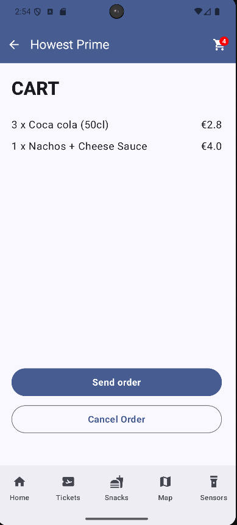

The room database is used for storing the shopping cart. 
It saves them to the cart_items table. The items themselves are fetched from the server. The structure is this:
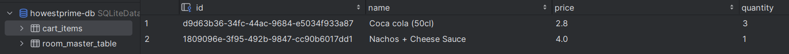

The DAOs handle the SQL queries.

##  API Requests
It uses the Retrofit library to make API requests. 
Currently the only endpoint is GET /snacks.json which calls your server (not mine as a student but yours as the teachers), and returns a list of snacks.
The JSON response is a list of snacks like this:
```json
  {
    "id": "a1b199d1-a06c-4889-a1e6-597e0f3a65ee",
    "name": "Sweet Popcorn",
    "image": "https://devicedev.vesper-design.be/assets/popcorn.png",
    "category": "Snack",
    "originalPrice": 4.50,
    "promoPrice": 3.50,
    "stock": 32,
    "promo": true,
    "promoDate": "2025-06-23",
    "description": "Fresh sweet popcorn, perfect for your movie.",
    "allergens": []
  }
```

It is used only in the Snacks screen for now:
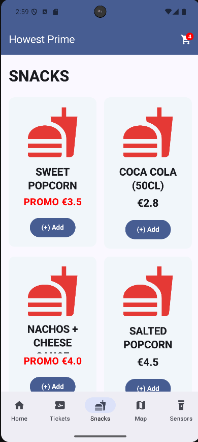

## MessageBroker
The app uses RabbitMQ for message broker for communication between the server and the client. When a user publishes a cart in the cart screen, it will send a message to the message broker in the receive-queue. Normally, the server would handle the message and send a response back to the sender. Now we still manually do it by posting in the send-queue then to get a response. It communicates in JSON which is automatically done. It is automatically serialized from kotlin to json and back.

It uses ConnectionFactory to define the connection, and it uses Hilt.

## Tickets
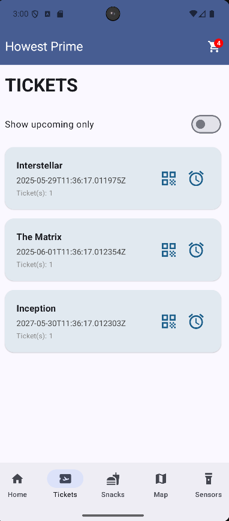
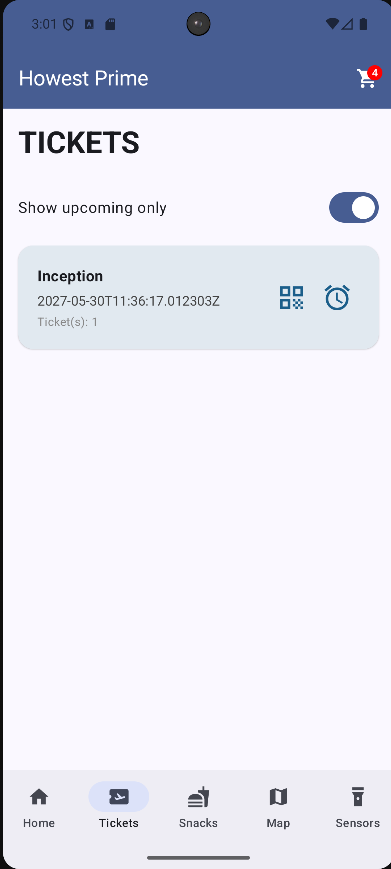

The tickets can be sent on the send-queue and the client will handle them. This is the data:
```json
{
  "ticketId": "T100","movieName": "Inception",
  "startTime": "2026-06-08T20:00:00",
  "room": "Room 4",
  "qrCodeData": "TICKET_12345"
}
```

The tickets will be saved in a room database.
The QR Code is a static image, not a generated QR code.

The tickets are saved like this:
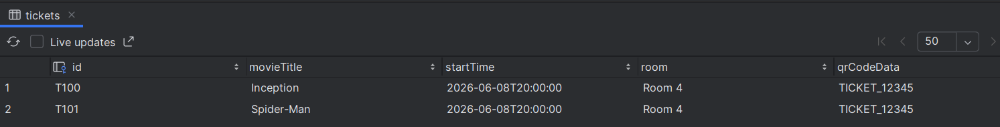

## Intents
The app uses intents to move the user between screens etc. When a user clicks a ticket in the ticketlistscreen, an intent carries the ticketId into the ticketdetailscreen to show the correct qr code. (This isn't implemented yet though but it would work that way). 
The app also uses sharing features (implicit intents) to communicate with other apps installed like the share order functionality. 
It also uses intents to open the correct page when clicking a notification (also not implemented yet).

## WorkManager
The WorkManager is used to handle background tasks. It makes it so things can happen like notifications even when the app is closed or the device restarts. In here it is used to monitor the OrderStatus updates from the message broker. Whenever a new order status gets published in the send-queue, it sends a notification to the user.

For example:
```json
{
"orderId": "b7c8a0f1",
"status": "READY",
"message": "Your order is ready for pickup!",
"location": "HowestPrime Snack Shop"
}
```

If you publish this on the send-queue, this shows in the app:
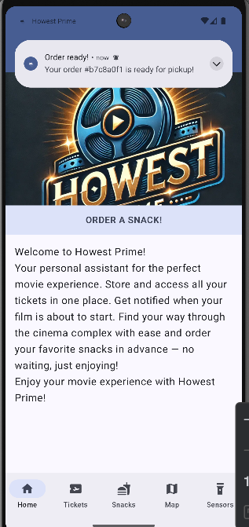
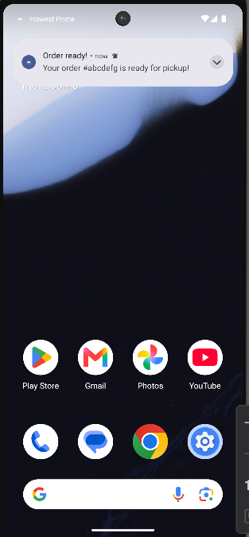

The notifications get handled through a worker called NotificationWorker. It handles the logic of building and sending the notification. This way it sends the notification even when the app isn't focussed.
It only runs when there is an internet connection though.

## Notifications
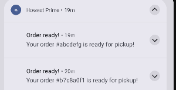
Notifications use the Android Notification API. Notifications get triggered by message broker messages from the send-queue queue. The workmanager triggers notificationworker to show a snack order reardy alert. 
Also, you can set a reminder notification for when the movie starts.
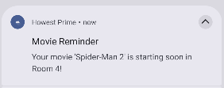
To test this, you need to publish a movie in the message broker with this:
```json
{
  "ticketId": "T103","movieName": "Spider-Man 2",
  "startTime": "2026-06-08T21:20:00",
  "room": "Room 4",
  "qrCodeData": "TICKET_12345"
}
```
To test 1 minute reminder, set the startTime of the movie 2 minutes in the future, then click the set reminder button. It will go off at 1 minute before the startTime.

##  Map
The map uses mapbox. It is focused on the howest buildings.
It is implemented using MapboxMap. It uses a locationcomponent to track the users real time position. It pauses the map and resumes when the activity is closed or opened or focussed to save battery.
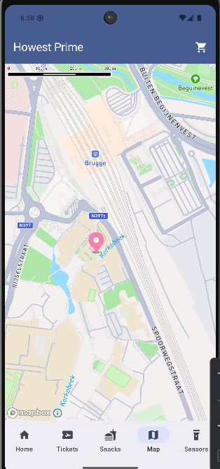

##  Sensor Data
The light sensor works as follows:
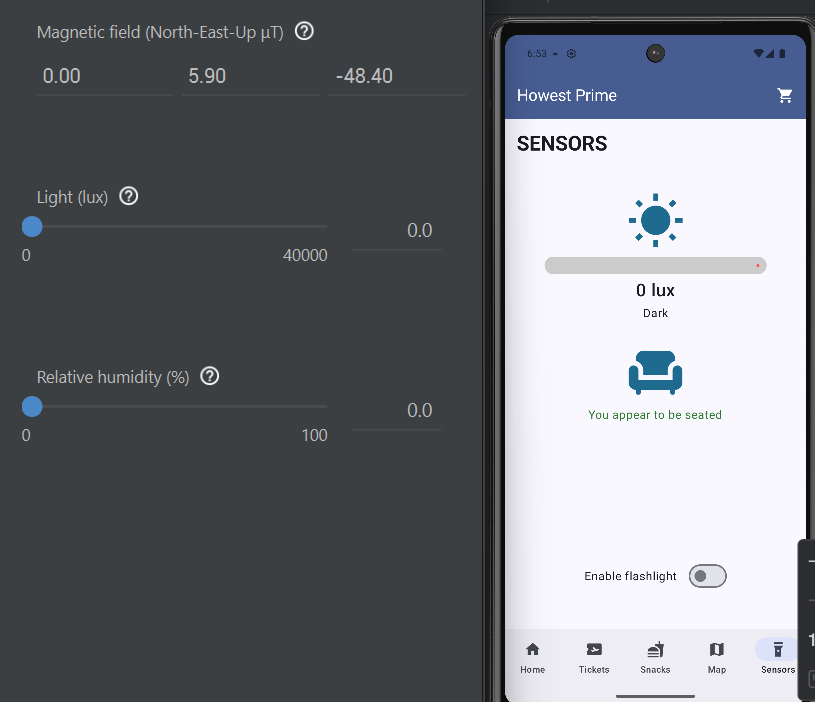
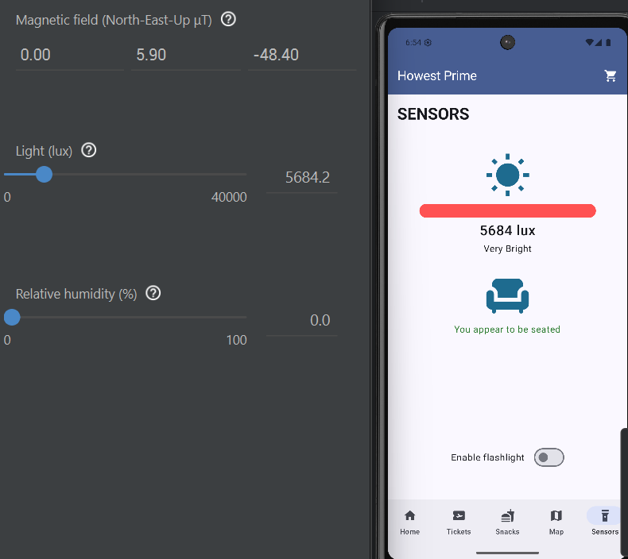
As you can see with virtual sensors, it correctly changes the lux and sets either Bright, very bright or dark. 
The proximity sensor also works, when it is below 100cm, it says seated, and above it says don't appear to be seated.
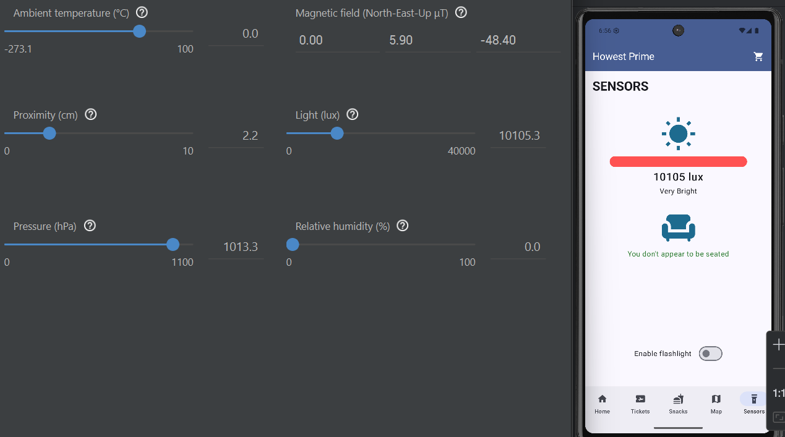
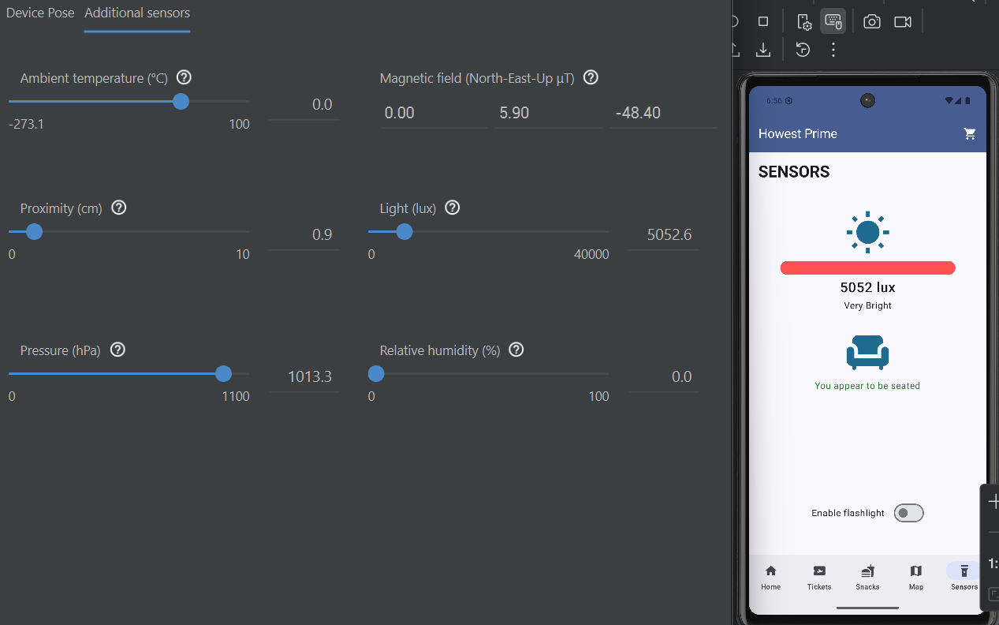

##  Camera (Optional)


Describe:
- QR scanning implementation
- Camera integration

# Repositories

## Code Repository
- https://github.com/Howest-TI-Project-BnD/st-client-mobile-Br4dleyV

## APK
- https://github.com/Howest-TI-Project-BnD/st-client-mobile-Br4dleyV/releases/download/1.0.0/howestprime.apk